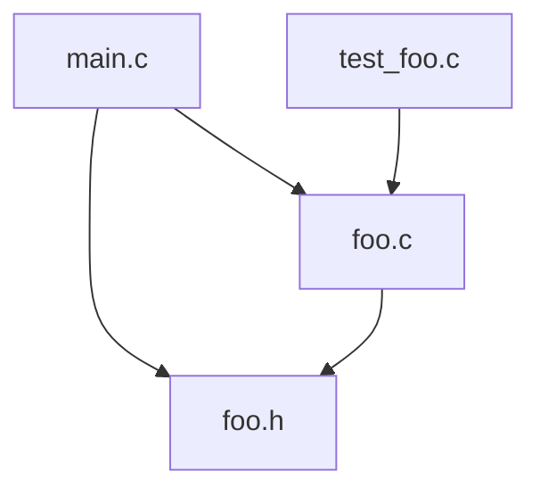

框架图（架构图、结构图、模块图等）是项目设计与回顾中非常重要的一部分，尤其对于C语言项目和嵌入式/车企领域。它能帮助你和团队快速理解项目整体结构、模块关系、数据流与接口分层，为后续维护、扩展和协作打下基础。

下面详细介绍**框架图绘制的常见类型、内容要素、常用工具、标准流程和具体案例**，并给出C项目的实际范例和可复用模板。

---

## 一、框架图常见类型

1. **模块结构图**  
   展示各个功能模块（如 main、foo、test）之间的关系和分层。
2. **数据流图（DFD）**  
   描述数据在各模块间流动的过程。
3. **调用关系图**  
   展示函数或接口间的调用关系。
4. **依赖关系图**  
   展示外部库、硬件、第三方模块间的依赖。
5. **时序图/状态机图**  
   描述系统的状态变化或事件顺序（嵌入式常见）。

---

## 二、框架图内容要素

- **模块名称与功能**：每个模块/文件的名字及其主要职责
- **接口说明**：模块对外暴露的函数/接口
- **数据结构**：主要结构体、全局变量
- **关系连线**：清晰展现模块间的调用、依赖、数据流动
- **分层**：如“主流程-功能模块-底层驱动”，体现架构分层思想
- **输入输出**：外部数据、用户操作、文件/硬件接口等

---

## 三、常用工具

1. **PlantUML**
    - 语法简单，纯文本可嵌入 Markdown，GitHub 支持渲染
2. **Graphviz（dot）**
    - 适合复杂流程和依赖关系，文本描述一键生成图片
3. **Mermaid**
    - Markdown内嵌、语法简单，GitHub、Typora直接支持
4. **Visio/Xmind/PowerPoint**
    - 可视化工具，适合正式文档或PPT展示
5. **手绘/白板**
    - 初期讨论、团队协作时快速记录

---

## 四、标准流程

1. **确定模块与分层**  
   列出所有主要模块（如 main.c, foo.c, foo.h, test_foo.c），梳理分层（如入口、逻辑、数据、测试）。
2. **梳理接口和数据流**  
   明确各模块的输入、输出、相互调用关系。
3. **选用工具建模**  
   用 PlantUML/Mermaid/Graphviz 画出初稿，标注每个模块的职责和接口。
4. **完善细节**  
   增加数据结构、关键变量、边界处理等辅助说明。
5. **输出到文档**  
   生成图片/代码块嵌入 README.md 或 docs/ 目录，便于团队查看和维护。

---

## 五、C项目实际范例（目录结构为例）

**假设你的项目结构如下：**

```
zhishidian/
├── CMakeLists.txt
├── src/
│   ├── main.c
│   ├── foo.c
│   └── foo.h
├── test/
│   └── test_foo.c
├── README.md
```

### A. PlantUML 模块结构图范例

```markdown name=docs/architecture.puml
@startuml
package "src" {
[main.c] --> [foo.c] : 调用
[foo.c] ..> [foo.h] : 引用头文件
}
package "test" {
[test_foo.c] --> [foo.c] : 单元测试
}
[main.c] --> [foo.h] : 包含声明
@enduml
```

渲染后效果：

- main.c 依赖 foo.h、foo.c
- foo.c 实现功能，依赖 foo.h
- test_foo.c 是测试模块，调用 foo.c

### B. Mermaid 示例（直接嵌入 Markdown）

````markdown name=docs/architecture.md

````

### C. 详细说明

- **main.c**：程序主入口，负责初始化和调用 foo.c 的功能
- **foo.c/foo.h**：实现和声明核心业务逻辑，供 main 和 test 调用
- **test_foo.c**：测试模块，独立验证 foo.c 的正确性

---

## 六、进阶建议（嵌入式/车企相关）

- 分层设计：建议以“应用层—业务逻辑层—硬件抽象层”结构划分，对应文件进行分组和说明
- 增加硬件模块（如 drivers/uart.c），在架构图中标注其与业务模块的关系
- 为每个模块写简要说明（职责、接口、依赖），便于团队协作和后期复盘
- 可以在架构图旁边附加表格，列出主要数据结构/接口函数及用途

---

## 七、输出到文档（范例）

在 README.md 或 docs/architecture.md 中嵌入架构图代码块，并配合简要说明：

````markdown name=docs/architecture.md
# 项目架构图


- **main.c**：主入口，负责初始化和主流程控制
- **foo.c/foo.h**：核心功能模块，封装主要业务逻辑
- **test_foo.c**：测试模块，验证核心功能正确性
````

---

## 总结

- 框架图可以用 PlantUML、Mermaid、Graphviz 等工具绘制，直接嵌入 Markdown 或生成图片
- 内容包括模块功能、接口、数据流、分层、依赖等
- 在嵌入式/车企项目中建议分层清晰，增加硬件抽象层和测试层说明
- 推荐每个模块配合简要职责和接口说明，帮助后续维护和复盘

如需为你的项目生成具体的框架图代码块或详细架构说明，欢迎提供项目模块说明或直接请求生成！
