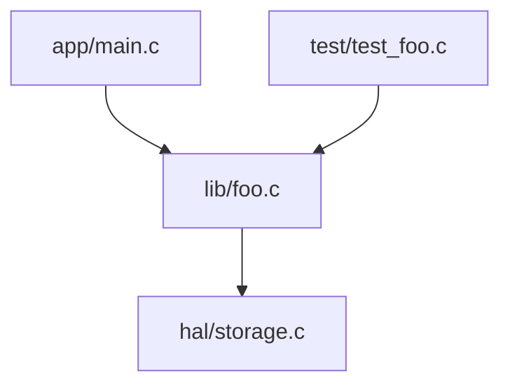

下面我把每一部分（分层设计、先写测试后写代码、以及其它必要建议）做为学习指南详细展开，并给出一套通用、可直接落地的模板（包含示例代码、CMake、测试和文档模板）。你可以把这些模板直接拷贝到项目里，按 TDD 流程实践并逐步替换实现细节。

先给出要点概览，然后给出可复制的文件模板（代码/构建/测试/文档）。文件以可粘贴的形式提供，Markdown 文件使用四反引号格式以确保内部代码块正确显示。

概览要点（快速读）

- 分层设计：清晰三层（应用层 / 业务逻辑层 / HAL），每层职责明确、接口稳定、依赖方向自顶向下。
- 先单元测试后写代码：采用 TDD（Test Driven Development）循环 — 写失败的测试 -> 写最少实现使其通过 -> 重构 -> 重复。
- 测试隔离：通过依赖注入（接口/函数指针）或链接替换（测试时替换 HAL 实现）来 mock 硬件。
- 工程化：用 CMake 管理、集成测试、启用 sanitizer、用 CI 自动化。
- 文档化：用 README、ARCHITECTURE、TESTING、CONTRIBUTING、ADR 等文件把设计/决策/如何运行写清楚。
- 行业要求：学习 MISRA/AUTOSAR 基本原则、静态分析与代码审查文化。

下面按用户请求分三大部分详细介绍，并在后面给出一套可复制的模板文件集合。

一、分层设计（Application — Business Logic — HAL）
目标：实现高内聚、低耦合、可替换底层与可单元测试的代码。

1. 三层职责（详述）

- 应用层（app/ 或 src/）
    - 以 main.c、UI/交互模块或协议栈为主。
    - 负责：启动/关机、配置、解析用户输入、调用业务接口、展示/传输结果。
    - 不得直接访问硬件寄存器或做底层 IO（应通过 HAL 接口）。
- 业务逻辑层（business/ 或 lib/）
    - 实现产品的核心功能/算法/状态机（例如：联系人管理、数据处理、协议解析）。
    - 通过抽象接口调用 HAL（如 storage_read/write、uart_send）。
    - 无全局对硬件的依赖，易于单元测试。
- 硬件抽象层 HAL（hal/）
    - 将具体外设/平台差异封装成简单一致的接口（init/read/write/flush）。
    - HAL 内部可调用 BSP、驱动或直接访问寄存器。
    - 测试时可被替换为“模拟 HAL”。

2. 接口设计原则

- 小而稳定的接口：函数签名尽量简单，传入必要上下文（context struct）而不是散布全局变量。
- 明确所有权：谁负责内存分配、谁释放。
- 返回值与错误码：统一使用 enum/宏定义错误码（避免裸 errno），文档中说明语义。
- 线程/中断安全：对并发场景说明是否可重入、是否需要外部加锁。

3. 依赖方向

- 仅从上向下依赖（应用 -> 业务 -> HAL）。反向依赖通过接口回调/事件通知实现（回调也是接口，但在文档中约定）。

4. 代码组织示例（目录）

```
project/
├── app/            # 应用层 (main, CLI/UI)
├── lib/            # 业务逻辑层 (核心功能)
│   ├── contact.c
│   └── contact.h
├── hal/            # 硬件抽象层 (platform-specific)
│   ├── storage.c
│   └── storage.h
├── test/           # 单元测试
├── docs/           # 架构/设计/ADR
├── CMakeLists.txt
```

5. 示例接口（约定）

- HAL 头示例（storage.h）导出：
    - int storage_init(void);
    - int storage_read(uint32_t addr, void \*buf, size_t len);
    - int storage_write(uint32_t addr, const void \*buf, size_t len);
- 业务层 contact.h 导出：
    - int contact_add(const char *name, const char *phone);
    - int contact_find(const char *name, contact_t *out);

二、先单元测试后撰写代码（TDD / PPD）

1. TDD 三步循环（红-绿-重构）

- 红（Red）: 编写一个期望的单元测试，用来描述功能的期望行为；运行测试，确认失败（测试用例还没实现）。
- 绿（Green）: 实现最少量的代码使测试通过（实现不求完美，只用于验证行为）。
- 重构（Refactor）: 在测试保护下重构代码，提升设计、移除重复、改善命名，保持测试全部通过。

2. TDD 在 C 项目的实践要点

- 每个新函数先写测试并定义其接口（header）。测试代码驱动接口细化。
- 对依赖（如 HAL）使用 mock：通过依赖注入（结构体函数指针）或在测试构建时用 mock_hal.c 覆盖真实 hal 实现。
- 小步提交：每次改动一个最小功能并通过测试。
- 使用测试框架（Unity、CMocka、Check、Criterion 等）；测试应尽量独立、快速、可重复。

3. Mock / Test-seam 技术（C 常用做法）

- 依赖注入（推荐）：在业务层接收一个 ops 结构体指针（函数指针集合）。
    - 运行时注入真实 HAL；测试时注入 Mock ops。
- 链接替换：把 hal 实现放在 hal_storage.c，在测试构建时链接 mock_storage.c（覆盖同名符号）。
- 编译时条件：#ifdef TEST 等，但尽量避免因为这会污染生产代码。

4. 示例 TDD 流程（具体）

- 步骤 A：在 test/ 中创建 test_contact_add.c，写入断言（比如添加成功，能通过 find 找到）。
- 步骤 B：运行测试（肯定失败），实现 contact_add 的最小版本，在 lib/contact.c 中。
- 步骤 C：运行测试直到通过，然后继续扩展更多场景（重复/边界/错误路径）。
- 使用 CI 将所有测试跑在每个 PR。

三、其他相关与必要建议（职业导向/实战提高）

1. 工具链与构建

- 使用 CMake 管理工程并生成 compile_commands.json（便于 clang-tidy/IDE）。
- 启用调试信息、Sanitizers（ASAN/UBSAN/TSAN）和地址/线程检查在开发阶段。
- 交叉编译：了解 toolchain file、QEMU 或目标板调试流程。

2. 静态分析与规范

- 定期运行 cppcheck、clang-tidy；企业级还会用 Coverity、PC-lint。
- 学习并遵循 MISRA C、CERT C 等安全编码规范（车规强烈建议）。

3. 文档/设计决策

- 用 ADR（Architecture Decision Records）记录关键决策（为何选择某个数据结构、协议、库）。
- 每个公开接口写 Doxygen 注释，保证能生成 API 文档。
- README、ARCHITECTURE、TESTING、CONTRIBUTING 是必须有的文档文件。

4. CI/CD 与质量门

- 在 GitHub Actions 上跑：构建（Debug/Release）、静态分析、测试（含 Sanitizers）、覆盖率生成（upload to codecov）。
- 可为 PR 设置“must pass tests”门。

5. 嵌入式/车企方向特别关注点

- 对实时性/内存约束敏感：避免动态分配（或限制动态分配），关注栈大小和堆碎片。
- 了解 CAN/LIN/UDS 等车载协议、ISO 26262 或相关安全流程（基本概念）。
- 熟练使用示波器/逻辑分析仪、调试串口、JTAG/SWD。

---

下面给出一套通用模板，可以直接放入你的项目以供实践（包含：CMakeLists、简单 HAL + 业务模块 + main、单元测试示例、README/ARCHITECTURE/TESTING 文档模板）。把这些文件复制到项目中并按 TDD 流程使用。

注意：Markdown 文件用四反引号包裹（开发者指示），其它源文件用文件块语法。

````markdown name=README.md
```markdown
# 项目名称（示例：zhishidian）

简要：本项目为学习用的 C 小项目，展示分层设计（app / business / hal）、TDD（先写测试后写实现）以及工程化构建（CMake + 测试）。

## 目录结构
```

zhishidian/
├── CMakeLists.txt
├── src/
│ ├── main.c
│ ├── foo.c
│ └── foo.h
├── hal/
│ ├── storage.c
│ └── storage.h
├── test/
│ └── test_foo.c
├── docs/
│ ├── ARCHITECTURE.md
│ └── TESTING.md
├── README.md
````

## 快速开始

依赖：gcc/clang, cmake >= 3.14

```sh
mkdir build
cd build
cmake -DCMAKE_BUILD_TYPE=Debug ..
cmake --build .
ctest --output-on-failure
```

启用 AddressSanitizer（本地开发）：

```sh
cmake -DCMAKE_BUILD_TYPE=Debug -DENABLE_SANITIZERS=ON ..
```

## 分层说明

- app: program entry（main.c）
- lib: 业务逻辑（foo.c / foo.h）
- hal: 硬件抽象（storage.h / storage.c），测试时可替换为 mock

## 测试与 TDD

- 使用单元测试（示例使用简单断言或 Unity），先写测试再写实现。
- 在 test/ 中添加测试文件，使用 CMake add_test 集成。

## 文档

- docs/ 目录包含架构说明（ARCHITECTURE.md）和测试说明（TESTING.md）。

## 贡献

Fork -> 新分支 -> 测试通过 -> PR（请附测试和变更说明）

## 许可证

MIT

```

```

`````

```cmake name=CMakeLists.txt
cmake_minimum_required(VERSION 3.14)
project(zhishidian C)

set(CMAKE_C_STANDARD 11)
option(ENABLE_SANITIZERS "Enable ASAN/UBSAN" ON)

if(ENABLE_SANITIZERS)
  set(SANITIZE_FLAGS "-fsanitize=address,undefined -fno-omit-frame-pointer")
  set(CMAKE_C_FLAGS "${CMAKE_C_FLAGS} ${SANITIZE_FLAGS} -g -O1")
endif()

# source files
add_library(libfoo STATIC src/foo.c)

# HAL is separate library so it can be substituted in tests
add_library(halstorage STATIC hal/storage.c)

# app executable
add_executable(zhishidian src/main.c)
target_link_libraries(zhishidian PRIVATE libfoo halstorage)

# tests
enable_testing()
add_executable(test_foo test/test_foo.c src/foo.c) # link business directly, mock HAL provided in test if needed
target_link_libraries(test_foo PRIVATE halstorage)  # override hal in test directory if using mock
add_test(NAME test_foo COMMAND test_foo)
```

```c name=hal/storage.h
#ifndef HAL_STORAGE_H
#define HAL_STORAGE_H

#include <stdint.h>
#include <stddef.h>

/* Simple storage abstraction */
typedef enum {
    STORAGE_OK = 0,
    STORAGE_ERR = -1
} storage_err_t;

int storage_init(void);
int storage_read(uint32_t addr, void *buf, size_t len);
int storage_write(uint32_t addr, const void *buf, size_t len);

#endif /* HAL_STORAGE_H */
```

```c name=hal/storage.c
#include "storage.h"
#include <stdio.h>
#include <string.h>

/* Minimal file-backed storage for host testing */
static const char *STORAGE_FILE = "storage.bin";

int storage_init(void) {
    /* create file if not exists */
    FILE *f = fopen(STORAGE_FILE, "rb+");
    if (!f) {
        f = fopen(STORAGE_FILE, "wb+");
        if (!f) return STORAGE_ERR;
    }
    fclose(f);
    return STORAGE_OK;
}

int storage_read(uint32_t addr, void *buf, size_t len) {
    FILE *f = fopen(STORAGE_FILE, "rb");
    if (!f) return STORAGE_ERR;
    if (fseek(f, addr, SEEK_SET) != 0) { fclose(f); return STORAGE_ERR; }
    size_t r = fread(buf, 1, len, f);
    fclose(f);
    return (r == len) ? STORAGE_OK : STORAGE_ERR;
}

int storage_write(uint32_t addr, const void *buf, size_t len) {
    FILE *f = fopen(STORAGE_FILE, "rb+");
    if (!f) f = fopen(STORAGE_FILE, "wb+");
    if (!f) return STORAGE_ERR;
    if (fseek(f, addr, SEEK_SET) != 0) { fclose(f); return STORAGE_ERR; }
    size_t w = fwrite(buf, 1, len, f);
    fflush(f);
    fclose(f);
    return (w == len) ? STORAGE_OK : STORAGE_ERR;
}
```

```c name=src/foo.h
#ifndef FOO_H
#define FOO_H

#include <stddef.h>

typedef struct {
    char name[32];
    char phone[16];
} contact_t;

/* return 0 on success, negative on error */
int contact_add(const contact_t *c);
int contact_find(const char *name, contact_t *out);
void contact_init(void);

#endif /* FOO_H */
```

```c name=src/foo.c
#include "foo.h"
#include "storage.h"
#include <string.h>
#include <stdio.h>

/* Simple fixed array in storage simulation (for learning/demo) */
#define MAX_CONTACTS 16
#define CONTACT_SIZE sizeof(contact_t)
#define STORAGE_BASE 0

static contact_t contacts[MAX_CONTACTS];

void contact_init(void) {
    /* load from storage if needed */
    if (storage_init() != STORAGE_OK) {
        /* fallback to zeroed contacts */
    } else {
        /* try to read entire contacts array */
        if (storage_read(STORAGE_BASE, contacts, sizeof(contacts)) != STORAGE_OK) {
            /* ignore read errors for now */
        }
    }
}

int contact_add(const contact_t *c) {
    for (int i = 0; i < MAX_CONTACTS; ++i) {
        if (contacts[i].name[0] == '\0') {
            contacts[i] = *c;
            /* persist */
            if (storage_write(STORAGE_BASE, contacts, sizeof(contacts)) != STORAGE_OK)
                return -2; /* persist failed */
            return 0;
        }
    }
    return -1; /* full */
}

int contact_find(const char *name, contact_t *out) {
    for (int i = 0; i < MAX_CONTACTS; ++i) {
        if (strncmp(contacts[i].name, name, sizeof(contacts[i].name)) == 0) {
            if (out) *out = contacts[i];
            return 0;
        }
    }
    return -1;
}
```

```c name=src/main.c
#include <stdio.h>
#include "foo.h"

int main(void) {
    contact_init();
    printf("Welcome to PhoneBook demo\n");
    /* simple demo add/find */
    contact_t c = { "Alice", "123456" };
    if (contact_add(&c) == 0) {
        printf("Added Alice\n");
    }
    contact_t out;
    if (contact_find("Alice", &out) == 0) {
        printf("Found: %s %s\n", out.name, out.phone);
    }
    return 0;
}
```

```c name=test/test_foo.c
#include <stdio.h>
#include <string.h>
#include <assert.h>
/* For TDD, we write this test before full features */
#include "foo.h"

/* Option A: If hal/storage is real file-backed, ensure we start clean */
extern int storage_init(void); /* provided by hal/storage.c */

static void reset_storage_file(void) {
    /* remove file created by storage.c if present */
    remove("storage.bin");
}

int main(void) {
    reset_storage_file();
    /* initialize business layer (which will call storage_init) */
    contact_init();

    contact_t c = {0};
    strncpy(c.name, "bob", sizeof(c.name)-1);
    strncpy(c.phone, "555", sizeof(c.phone)-1);

    int rc = contact_add(&c);
    assert(rc == 0);

    contact_t out = {0};
    rc = contact_find("bob", &out);
    assert(rc == 0);
    assert(strcmp(out.phone, "555") == 0);

    printf("test_foo: OK\n");
    return 0;
}
```

````markdown name=docs/ARCHITECTURE.md
````markdown
# 架构说明（ARCHITECTURE）

## 分层（概览）

- 应用层（app/ 或 src/main.c）
    - 启动、配置、用户交互
- 业务层（lib/ 或 src/foo.c）
    - 核心功能，独立于硬件
- 硬件抽象层（hal/）
    - 提供统一的存储/IO接口

## 模块图（Mermaid）


`````

## 接口约定

- HAL 返回值使用 storage_err_t 枚举，0 表示 ok。
- 所有 API 明确谁负责内存释放。
- 不允许业务层直接 fopen/fwrite 等宿主 IO（宿主 IO 只在 HAL 中实现）。

## 设计决策（示例 ADR）

1. 为什么有 HAL？ -> 为了便于在 PC 上测试并在目标硬件上替换实现。
2. 为什么用固定数组为演示？ -> 简化示例，真实产品应使用动态结构或数据库。

```

```

`````

````markdown name=docs/TESTING.md
````markdown
# 测试文档

## 测试流程（TDD）

1. 在 test/ 下添加测试文件 test_xxx.c，写断言描述预期行为。
2. 运行 `cmake .. && make`，执行 `ctest` 或直接运行可执行测试。
3. 测试失败 -> 在 lib/ 中实现最小逻辑 -> 运行测试直到通过 -> 重构。

## Mock 与替换 HAL

- 方法一：链接替换（提供 mock_storage.c，在测试构建时覆盖 hal/storage.c）
- 方法二：依赖注入（将 ops 结构在业务层传入）

## 本地快速运行

```sh
mkdir build && cd build
cmake -DENABLE_SANITIZERS=ON ..
cmake --build .
./test/test_foo   # 或 ctest --output-on-failure
```
`````

## CI 建议

- 在 CI 中运行： gcc/clang build, static analysis (cppcheck/clang-tidy), tests, coverage, asan/ubsan for debug.

```

```

`````

````markdown name=CONTRIBUTING.md
```markdown
# Contributing

- Fork -> feature branch -> commit -> PR.
- 每个 PR 要包含：
    - 变更说明
    - 测试用例（新增功能/修复 bug 必须跟随测试）
    - 通过所有 CI 流程
- 代码风格：clang-format（推荐）
- 写清楚接口和错误码变化，遵循语义化版本控制（SemVer）
```
`````

实战建议（如何使用这些模板并按学习路线）

1. 将上述文件放入仓库的对应路径（src, hal, test, docs）。先把测试文件（test/test_foo.c）作为 TDD 的第一个测试写好。
2. 运行 CMake / make / ctest（把 BUILD 设置为 Debug、启用 Sanitizers）。
3. 模拟一次失败：删掉 foo.c 的实现，让 test 失败，观察失败信息，再实现最少功能让测试通过。
4. 添加更多测试覆盖边界和错误路径（如 storage 写入失败、contact 重复添加、超出容量）。
5. 尝试替换 hal/storage.c 为 mock（编写 mock_storage.c），以便单元测试快速而稳定。
6. 集成静态分析：运行 cppcheck、clang-tidy，修复警告。
7. 撰写 ARCHITECTURE.md、TESTING.md、CONTRIBUTING.md，必要时写 ADR 文件记录重大设计决策。
8. 学习 MISRA/AUTOSAR 的要点，并尝试用 clang-tidy 的规则或 MISRA 工具检查代码（非强制，但长期有利）。

常见学习里程碑（建议）

- 第 1 周：掌握 CMake, 构建、运行、基础 TDD 流程（写 3 个测试并实现功能）。
- 第 2 周：引入静态分析、Sanitizers，修复检测到的问题。
- 第 3 周：实现 mock HAL 并编写更多边界/错误路径测试。
- 第 4 周：写文档（ARCHITECTURE、TESTING），并把 CI（GitHub Actions）配置为自动执行以上步骤。

如果你希望，我可以：

- 把上面的文件内容直接提交为一个 PR（需要仓库权限/确认目标仓库），或者
- 帮你把模板里的某些实现改成依赖注入风格以方便单元测试（即示例 foo.c 改为接收 storage ops），或
- 生成一个 GitHub Actions workflow 文件用于 CI（编译、测试、sanitizers、coverage）。
